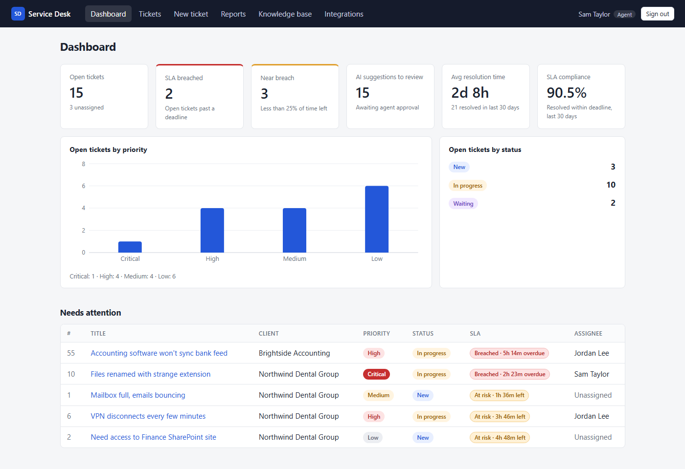
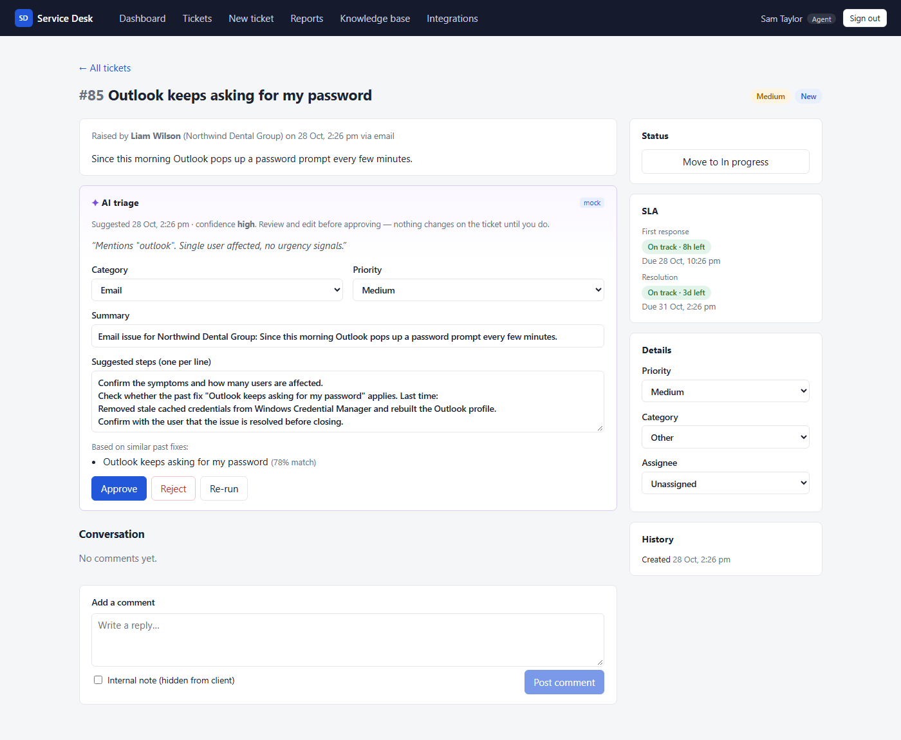
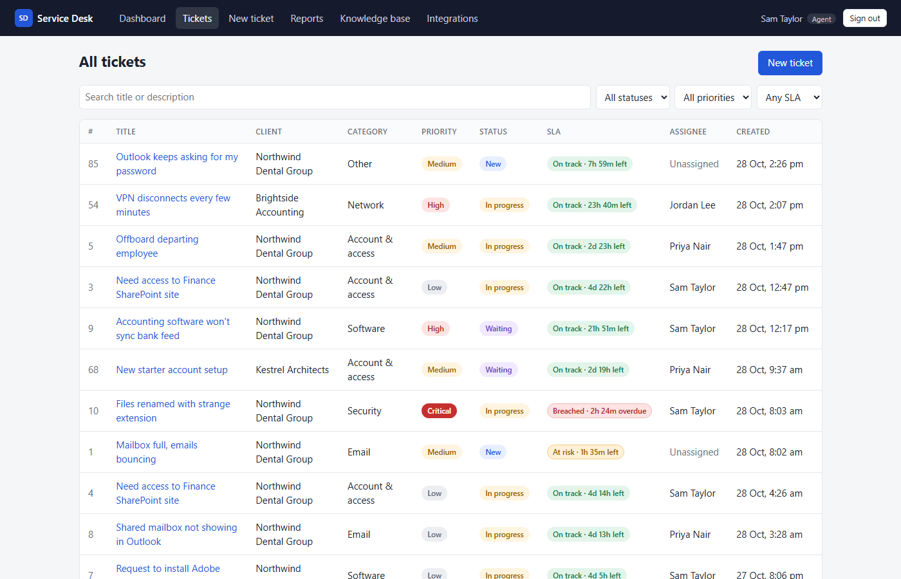
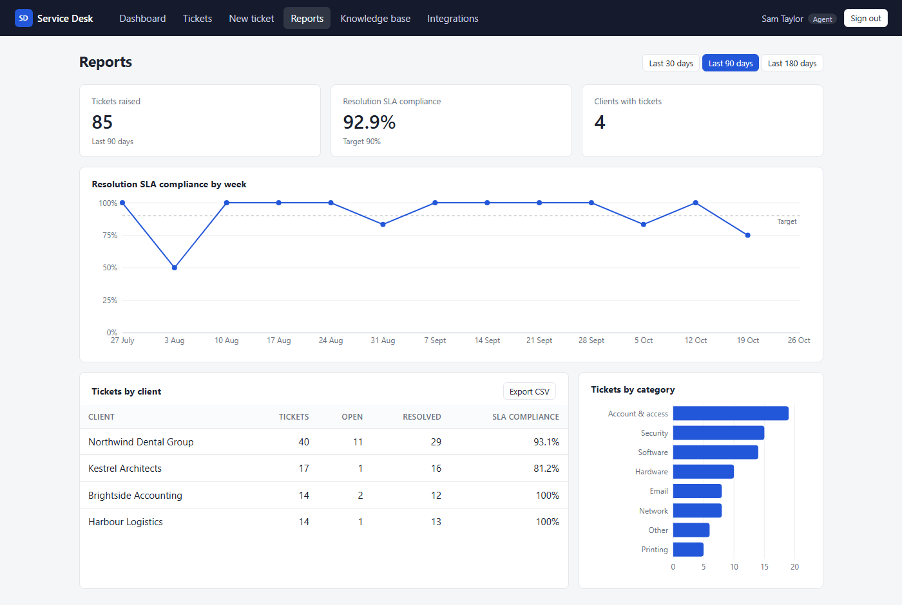
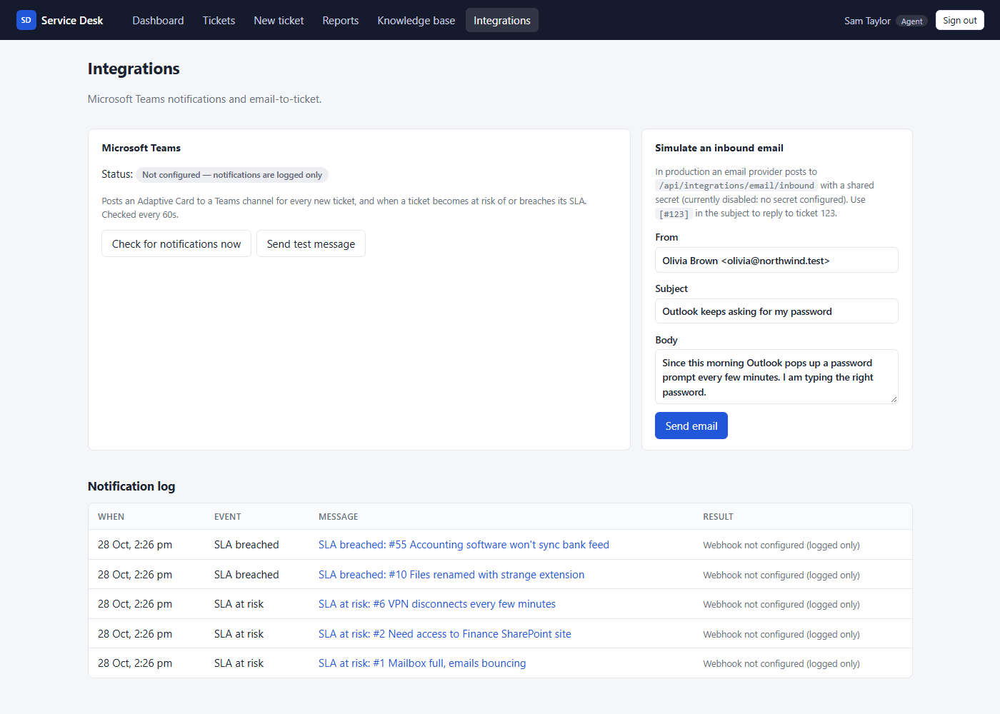
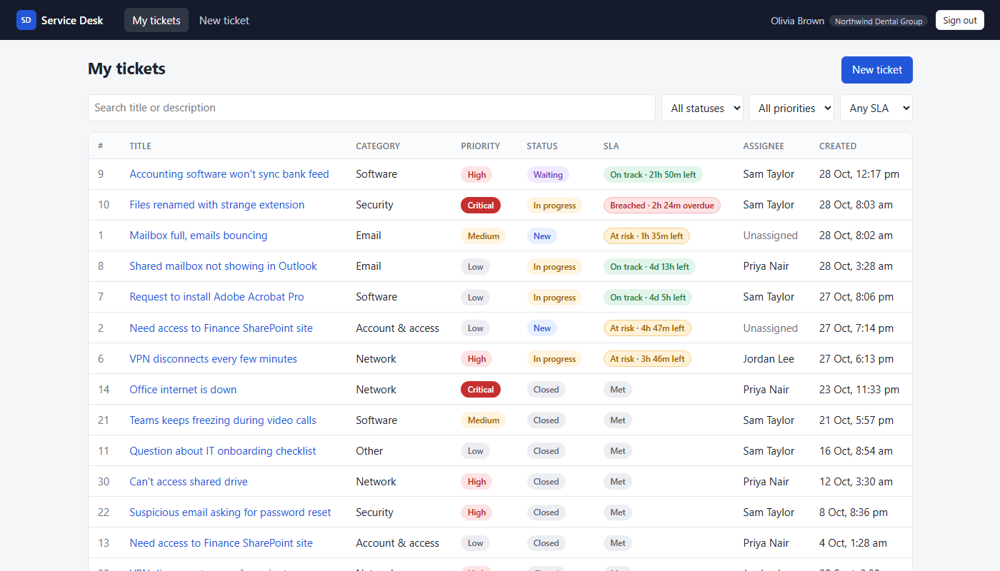
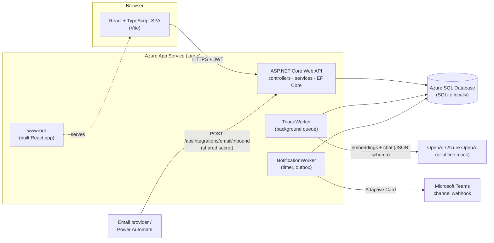
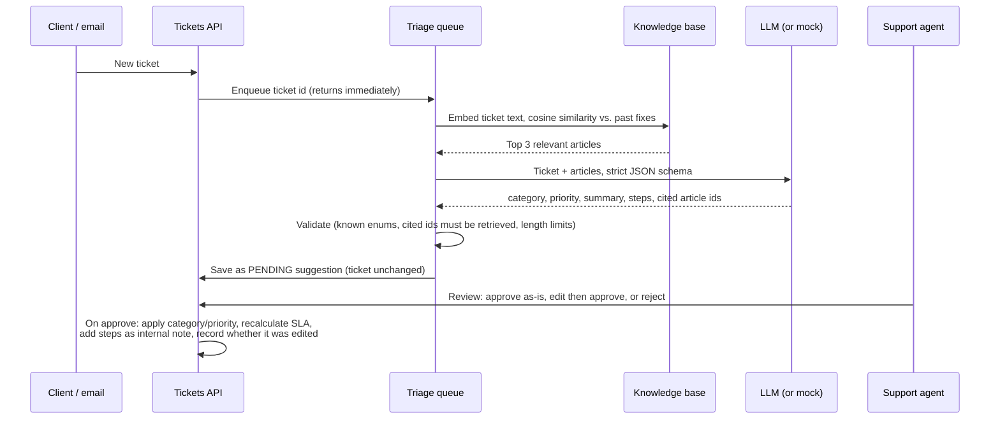

# AI-assisted IT Service Desk

A service desk for a managed service provider (MSP): client staff raise IT tickets, support agents work them
against SLAs, and an **AI triage agent** reads each new ticket, searches a knowledge base of past fixes (RAG)
and suggests a category, priority, summary and solution steps — which **an agent must approve or edit**
before anything changes.

[](https://github.com/maisha272/AI-assisted-IT-service-desk/actions/workflows/ci.yml)


| Demo account | Email | Password |
|---|---|---|
| Support agent | `sam@servicedesk.test` | `Demo123!` |
| Client staff (Northwind Dental) | `olivia@northwind.test` | `Demo123!` |

The login page has one-click buttons for both.

## Screenshots

| Agent dashboard | AI triage review |
|---|---|
|  |  |
| **Ticket queue with SLA countdowns** | **Reports** |
|  |  |
| **Integrations (Teams + email-to-ticket)** | **Client staff view** |
|  |  |

## Features

- **Roles:** client staff create and follow their own tickets; support agents manage every ticket. Enforced
  in the API (JWT + role and row-level checks), not just hidden in the UI.
- **Tickets:** clients, users, comments (with agent-only internal notes) and a full status history.
  Status flow `New → In progress ⇄ Waiting → Resolved → Closed`, with reopen; invalid moves are rejected.
- **SLA tracking:** response and resolution deadlines per priority (Critical 1h/4h … Low 24h/5d).
  Tickets are flagged *at risk* (under 25% of the time left) or *breached*, with live countdowns.
- **Dashboard:** open tickets by priority and status, near-breach and breached tickets, average resolution
  time, SLA compliance, and a "needs attention" queue.
- **AI triage agent (RAG + human in the loop):** retrieves similar past fixes, asks an LLM for a structured
  suggestion, validates it, and shows it with its sources for an agent to approve, edit or reject.
  Runs in **mock mode** with no API key, so the whole app works offline.
- **Knowledge base:** past fixes with semantic search; agents can save a resolved ticket's fix so the AI
  can suggest it next time.
- **Integrations:** Microsoft Teams notifications (new ticket, SLA at risk, SLA breached) via an Adaptive
  Card webhook, and **email-to-ticket** via an inbound email webhook (replies with `[#123]` become comments).
- **Reporting:** tickets by client and category, weekly SLA compliance trend, CSV export.
- **Quality:** 130+ xUnit tests (unit, service and API integration) and Vitest component tests, run by
  GitHub Actions on every push; deployment to Azure on merge to `main`.

## Architecture



- **One deployable:** the API serves the built React app, so there's a single URL and no CORS.
- **Business rules live in the API** (`Services/`): the status state machine, SLA policy, access rules and
  AI-output validation are plain C# classes, unit-tested without a database.
- **Background work never blocks a request:** new tickets are queued for AI triage; Teams notifications
  are sent by a timer that reads "not yet notified" markers on tickets (a simple outbox), so a slow webhook
  can't slow down or break ticket creation.

## How the AI triage works



1. **Retrieve.** The ticket's title and description are turned into an embedding vector and compared
   (cosine similarity) with the stored vectors of every knowledge article. The top 3 above a relevance
   threshold are kept.
2. **Generate.** The ticket and those articles go to the model with a system prompt and a **strict JSON
   schema** (OpenAI structured outputs), so the answer is always machine-readable.
3. **Validate.** Model output is treated as untrusted input: unknown categories or priorities fall back
   to the ticket's current values, cited articles must be ones that were actually retrieved, and step
   count and lengths are capped.
4. **Human in the loop.** The suggestion is saved as *pending* and shown to agents with the model's
   rationale, confidence and sources. Nothing changes until an agent approves; they can edit any field
   first. The original suggestion and the final values are both stored, so `GET /api/triage/stats`
   reports how often suggestions are accepted as-is, edited or rejected.

**Prompt injection:** ticket text is written by end users, so the system prompt marks it as untrusted
data, it's sent as delimited JSON, the model has no tools or write access, and a human approves every
change.

**Mock mode:** with no API key, embeddings use the hashing trick (shared words, not meaning) and
suggestions come from keyword rules — the full flow works for the demo, in CI and in tests at no cost.
Set `AI__Provider` and `AI__ApiKey` to use OpenAI or Azure OpenAI; existing articles are re-embedded
automatically when the embedding model changes.

## Tech stack

| Area | Technology |
|---|---|
| API | ASP.NET Core 9 Web API (C#), controllers, ProblemDetails, rate limiting, health checks |
| Data | Entity Framework Core 9 — SQL Server / Azure SQL in production, SQLite locally and in tests |
| Auth | JWT bearer tokens, ASP.NET Core `PasswordHasher` (PBKDF2), role-based + row-level authorization |
| AI | OpenAI or Azure OpenAI (chat completions with JSON schema, embeddings) via `HttpClient`; offline mock |
| Front end | React 19, TypeScript, Vite, React Router, Recharts |
| Tests | xUnit, `WebApplicationFactory`, `FakeTimeProvider`; Vitest + React Testing Library |
| CI/CD | GitHub Actions → Azure App Service (Linux, F1) + Azure SQL Database (free offer) |
| Containers | Multi-stage Dockerfile, docker-compose with SQL Server 2022 |

## Run it locally

**Prerequisites:** [.NET 9 SDK](https://dotnet.microsoft.com/download) and [Node.js 22+](https://nodejs.org).
No database or API key needed — it uses SQLite and mock AI mode.

```bash
# Terminal 1 — API on http://localhost:5080 (creates and seeds servicedesk.db on each start)
dotnet run --project src/ServiceDesk.Api

# Terminal 2 — React app on http://localhost:5173 (proxies /api to the API)
cd web
npm install
npm run dev
```

Open http://localhost:5173 and use a demo account.

**Run the tests**

```bash
dotnet test          # API: unit, service and integration tests
cd web && npm test   # front end: Vitest
```

**Production-like run with Docker** (SQL Server + the production image):

```bash
cp .env.example .env   # set SQL_SA_PASSWORD and JWT_SIGNING_KEY
docker compose up --build
# http://localhost:8080
```

**Use a real LLM** (optional) — keep keys out of the repo with user secrets:

```bash
cd src/ServiceDesk.Api
dotnet user-secrets init
dotnet user-secrets set "AI:Provider" "OpenAI"
dotnet user-secrets set "AI:ApiKey" "sk-..."
# Azure OpenAI: AI:Provider=AzureOpenAI, AI:Endpoint=https://<resource>.openai.azure.com,
#               AI:ChatModel=<chat deployment>, AI:EmbeddingModel=<embedding deployment>
```

## Configuration

All settings can be environment variables (`Section__Key`). Nothing secret is committed; see
[.env.example](.env.example).

| Setting | Default | Notes |
|---|---|---|
| `Database__Provider` | `Sqlite` | `SqlServer` in Azure |
| `ConnectionStrings__Default` | `Data Source=servicedesk.db` | |
| `Jwt__SigningKey` | random per start (dev) | **Required in Production**, 32+ characters |
| `AI__Provider` | `Mock` | `OpenAI` or `AzureOpenAI` (falls back to mock without a key) |
| `AI__ApiKey`, `AI__Endpoint`, `AI__ChatModel`, `AI__EmbeddingModel` | | `gpt-4o-mini`, `text-embedding-3-small` by default |
| `Integrations__TeamsWebhookUrl` | empty | Empty = notifications are logged only |
| `Integrations__InboundEmailSecret` | empty | Empty = inbound email endpoint disabled |
| `Integrations__PublicUrl` | `http://localhost:5173` | Used for links in Teams cards |

## CI/CD and deployment

[`.github/workflows/ci.yml`](.github/workflows/ci.yml) runs on every push and pull request:

1. **API job** — restore, build, run all xUnit tests.
2. **Web job** — `npm ci`, ESLint, Vitest, production build (includes TypeScript type-checking).
3. **Deploy job** (pushes to `main` only, after both pass) — builds the React app into the API's
   `wwwroot`, publishes, deploys to Azure App Service and smoke-tests `/health`.

Database migrations are applied on startup. Step-by-step Azure setup (free tier) is in
[docs/DEPLOYMENT.md](docs/DEPLOYMENT.md).

## Project structure

```
src/ServiceDesk.Api/
  Controllers/        HTTP endpoints (thin)
  Domain/             Entities and enums
  Data/               EF Core DbContext, migrations, seed data
  Dtos/               Request/response records and mapping
  Services/           Business logic: TicketWorkflow, SlaPolicy, Dashboard, Reports
    Auth/             JWT, password hashing, roles
    Triage/           RAG pipeline, OpenAI client, mock model, background queue
    Integrations/     Teams notifier, notification dispatcher, inbound email
tests/ServiceDesk.Tests/   xUnit tests (Domain, Services, Triage, Integrations, Api)
web/src/
  api/                Typed API client and DTO types
  auth/               Auth context and route guard
  components/         Badges, SLA badge, triage panel, stat tiles
  pages/              Dashboard, tickets, reports, knowledge base, integrations, login
docs/                 Deployment guide, screenshots
```

## How this was built

Built with Claude Code; I reviewed and tested the generated code.

## What I'd improve next

- **Business-hours SLAs** with per-client contracts and public holidays, and pausing the clock while a
  ticket is waiting on the customer.
- **Microsoft Entra ID sign-in** (OpenID Connect) instead of local passwords, plus refresh tokens;
  HttpOnly-cookie sessions to reduce XSS exposure.
- **Durable background work:** Azure Service Bus or Azure Functions instead of the in-memory triage queue,
  with retries and backoff for Teams notifications.
- **AI quality:** an evaluation set of real tickets with expected categories run on each prompt change;
  tool-calling so the agent can check device or service status; a vector index (Azure AI Search) once the
  knowledge base grows.
- **Email:** outbound replies to clients, attachments, de-duplication by Message-ID.
- **Testing:** Playwright end-to-end tests, and running the API tests against SQL Server in CI
  (Testcontainers).
- **Infrastructure as code** (Bicep) and GitHub → Azure OIDC federation instead of a publish profile.
- Pagination and server-side sorting for large ticket lists.
